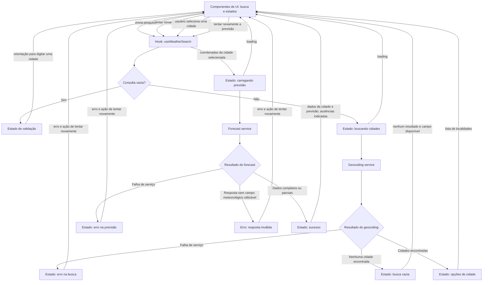

# Plano Técnico — Weather App

Este plano deriva da [especificação de produto](../specs/weather-app-spec.md).
Os requisitos FR-01 a FR-06 e os critérios AC-01 a AC-06 são a referência para
as decisões abaixo. Os tipos são contratos conceituais para orientar a
implementação; não são código final.

## Architecture

Aplicação cliente sem backend próprio, organizada em camadas com dependências
direcionadas da apresentação aos dados. Componentes React apresentam a
interface e encaminham ações; hooks orquestram o estado e o fluxo assíncrono;
serviços isolam chamadas HTTP à Open-Meteo; funções puras em `lib/` normalizam
respostas e calculam valores de apresentação.

```text
components (apresentação)
       │ ações / dados para renderização
       ▼
hooks (orquestração e estado)
       │ operações de dados
       ▼
services (HTTP e erros de transporte)
       │ payloads externos
       ▼
lib (normalização e funções puras)

types define contratos compartilhados entre as camadas.
```

- Manter dependências unidirecionais: componentes não chamam serviços nem
  conhecem o formato da API; hooks não constroem payloads externos; serviços
  não dependem de React.
- Separar a resposta externa do modelo de domínio: serviços cuidam do
  transporte HTTP e `lib/` valida/normaliza os payloads antes de expô-los ao
  restante da aplicação.
- Manter lógica de apresentação sem efeitos colaterais em funções puras sempre
  que ela puder ser expressa como transformação de entradas em saídas.
- Manter uma única aplicação web responsiva, sem API própria, banco de dados,
  autenticação, analytics ou armazenamento de consultas/preferências.
- Usar coordenadas da localidade selecionada para carregar o clima; não
  resolver a cidade novamente pelo texto do nome.
- Exibir a atribuição Open-Meteo exigida na tela de resultados, após confirmar
  suas condições de uso antes da implementação.

## Tech Stack

| Área | Decisão | Motivo |
|---|---|---|
| Linguagem | TypeScript strict | Contratos explícitos para respostas externas e estados da UI. |
| Interface | React 19 + Vite | Stack já configurada no repositório e adequada a uma SPA simples. |
| Estilo | Tailwind CSS | Stack do projeto; permite interface responsiva e tema dark glassmorphism sem introduzir outra camada de UI. |
| Dados | `fetch` nativo, encapsulado em `src/services/` | Evita dependência de cliente HTTP para duas operações simples. |
| Testes | Vitest + Testing Library; Playwright para E2E | Ferramentas já previstas/configuradas no projeto. |
| Qualidade | Biome | Lint e formatação definidos pelo projeto. |

Não introduzir cache, gerenciamento de estado externo, persistência ou
dependências adicionais sem necessidade demonstrada.

## Project Structure

Estrutura proposta para a implementação, ainda não existente no repositório:

```text
src/
  App.tsx
  main.tsx
  components/
    CitySearch.tsx        # Busca e seleção acessível de localidades
    SearchBar.tsx         # Campo e envio explícito da consulta
    CityResults.tsx       # Condições atuais, cinco dias e atribuição
    UnitToggle.tsx        # Controle Celsius/Fahrenheit
  hooks/
    useWeatherSearch.ts   # Orquestra busca, seleção, previsão e estado
  services/
    geocodingService.ts   # Requisição HTTP de geocoding e erros de transporte
    weatherService.ts     # Requisição HTTP de previsão e erros de transporte
  lib/
    normalizeGeocoding.ts # Validação e normalização do payload de geocoding
    normalizeWeather.ts   # Validação e normalização do payload de previsão
    temperature.ts        # Conversão, arredondamento e apresentação
    weatherCodes.ts       # Descrições pt-BR e ícones de códigos WMO
    date.ts               # Datas locais da cidade e formatação pt-BR
  types/
    weather.ts            # Contratos compartilhados de domínio e estados
tests/
  unit/                   # Funções puras, normalizadores e serviços
  components/             # Interação e renderização com Testing Library
  e2e/                    # Fluxos principais com respostas de API controladas
```

### Responsabilidades por camada

- **`components/` — apresentação:** renderizam busca, opções, resultados e
  controle de unidade; encaminham eventos para o hook e exibem os estados
  recebidos. Não fazem `fetch`, não montam URLs e não interpretam payloads
  externos. Devem manter semântica, acessibilidade e estados visuais de
  carregamento, vazio, sucesso e erro.
- **`hooks/` — orquestração e estado:** coordenam consulta, busca, seleção de
  cidade, previsão, unidade e retry. Chamam os serviços, controlam operações
  assíncronas e impedem que respostas obsoletas substituam resultados mais
  recentes. Mantêm o estado local da página, sem introduzir estado global.
- **`services/` — acesso a dados:** encapsulam `fetch`, construção de URL e
  parâmetros, timeout e classificação de falhas de transporte. Encaminham os
  payloads para os normalizadores de `lib/` e retornam dados de domínio ou
  erros tipados; não contêm lógica de interface nem dependem de React.
- **`lib/` — funções puras:** contém transformações determinísticas sem efeitos
  colaterais, como validação/normalização de payloads, conversões de
  temperatura, mapeamento WMO e operações de datas locais. As funções recebem
  dados explícitos e retornam resultados, sem acessar rede, estado React ou
  ambiente global mutável.
- **`types/` — contratos:** reúne os tipos compartilhados de domínio, unidade,
  estados assíncronos e erros. Os payloads externos podem ter tipos internos
  aos normalizadores; a UI consome os contratos normalizados.

Essa divisão mantém cada camada substituível e limita o impacto de mudanças:
alterações de API ficam nos serviços/normalizadores, mudanças de fluxo no hook
e ajustes visuais nos componentes. Manter componentes pequenos; adicionar
arquivos apenas quando houver responsabilidade clara, reutilização ou valor de
teste independente.

`SearchBar` implementa o campo de T-21 com `onSearch(city: string)` e
`disabled?: boolean` (padrão `false`). O formulário tem `role="search"`, label
associado e envio por botão ou Enter. Consultas em branco exibem orientação
acessível sem chamar `onSearch`; consultas válidas removem apenas espaços nas
extremidades. `disabled` bloqueia edição e envio. O componente usa o tema
glassmorphism e não consulta serviços; opções e estados de rede permanecem
responsabilidade da composição de busca.

`CurrentWeather` implementa o hero de T-23 com props `city: City`,
`current: CurrentWeather` e `unit: Unit`. Usa `lib/temperature` para formatar
temperaturas inteiras (empates para longe de zero) e `lib/weatherCodes` para
descrições e ícones Unicode, sem dependências extras. A descrição normalizada,
quando presente, tem preferência sobre a tabela. Códigos desconhecidos usam
ícone neutro, nunca uma condição inferida. O layout glass responsivo usa uma
seção nomeada e uma lista de definições para as quatro métricas; ícones são
decorativos, pois a condição já é textual.

Os campos opcionais `humidityPercent`, `windSpeedKmh`, `precipitationMm` e
`pressureHpa` aceitam `number | null`, preservando consumidores existentes.
Ausência, valores não finitos, umidade fora de 0–100, vento/precipitação negativos
e pressão não positiva são exibidos como “Indisponível”. Métricas usam pt-BR com
até uma casa decimal, nas unidades fixas %, km/h, mm e hPa. O componente é
apenas de apresentação; loading/erro, horário/atualidade, atribuição e integração
com a API continuam na composição de resultados e nas tarefas correspondentes.

## Data Model

### Composição de App integrada ao hook

`App` consome `status`, `data`, `error`, `search` e `retry` de `useWeather`.
Mantém apenas `unit: Unit` (inicialmente Celsius) como estado local de UI.
Não importa mocks nem oferece seletor demonstrativo. Reutiliza `SearchBar`,
`UnitToggle`, `CurrentWeather`, `ForecastList` e os componentes de estado.

`SearchBar.onSearch` encaminha a consulta ao hook; `ErrorState.onRetry` chama
`retry` e apresenta a mensagem de erro recebida. A tela inicia em `idle` e
loading desabilita a busca, não o controle de unidade. Somente `success` com
dados apresenta condições atuais e previsão. `CurrentWeather` e `ForecastList`
recebem os dados retornados e a mesma unidade, convertendo na renderização pelos
utilitários existentes. As transições não alteram a unidade nem o toggle
dispara requisições. A seleção automática da primeira cidade é o comportamento
atual do hook; seleção manual e estados independentes são entregas posteriores.

O header responsivo contém marca, busca e toggle; o conteúdo principal alterna
os cenários sem manter resultados obsoletos visíveis. `main.tsx` monta `App`
em StrictMode e importa `index.css` com as diretivas Tailwind e o tema global.
Testes de composição usam serviços simulados para verificar os cinco estados,
busca, retry da etapa que falhou, bloqueio durante loading e conversão de todas
as temperaturas sem mutação dos dados. E2E intercepta geocoding e forecast.

`ForecastList` recebe `forecast: ForecastDay[]` e `unit: Unit` e renderiza uma
seção “Previsão de 5 dias” com lista ordenada no grid
`grid-cols-2 sm:grid-cols-3 lg:grid-cols-5`. Cada `ForecastCard` recebe `day`,
`index` e `unit`. `lib/format` fornece `getDayLabel(localDate, index)` e
`getShortDate(localDate)`, validando datas YYYY-MM-DD e formatando componentes
UTC em pt-BR sem depender do relógio ou fuso do dispositivo. Os índices 0 e 1
representam hoje e amanhã conforme o contrato de ordenação da fonte.
Temperaturas e condições reutilizam `lib/temperature` e `lib/weatherCodes`.
`precipitationProbabilityPercent?: number | null` preserva consumidores
existentes; somente valores finitos entre 0 e 100 são exibidos como percentuais.
Campos inválidos ficam explicitamente indisponíveis. Lista vazia comunica
“Previsão indisponível”; os cinco dias e o preenchimento de lacunas continuam
sendo responsabilidade da normalização em T-13. Loading/erro de rede ficam
na composição de resultados.

Contratos de domínio normalizados, separados dos payloads da Open-Meteo e com
nomes em camelCase. `null` representa campo ausente ou inválido na resposta;
esses valores são mostrados como indisponíveis e nunca formatados como
temperaturas ou condições válidas.

```ts
export type Unit = "celsius" | "fahrenheit"; // Unidade de exibição.

export interface City {
  id: number | null; // Identificador retornado pelo geocoding.
  name: string; // Nome da localidade.
  country: string | null; // Nome do país (country).
  region: string | null; // Estado ou região (admin1).
  latitude: number; // Latitude em graus decimais.
  longitude: number; // Longitude em graus decimais.
}

export interface CurrentWeather {
  temperatureCelsius: number | null; // Temperatura a 2 m (temperature_2m), em °C.
  weatherCode: number | null; // Código meteorológico WMO (weather_code).
  descriptionPtBr: string | null; // Descrição derivada do código WMO em pt-BR.
  sourceLocalTime: string | null; // Horário local de referência (current.time).
  humidityPercent?: number | null; // Umidade relativa em %.
  windSpeedKmh?: number | null; // Velocidade do vento em km/h.
  precipitationMm?: number | null; // Precipitação em mm.
  pressureHpa?: number | null; // Pressão atmosférica em hPa.
}

export interface ForecastDay {
  localDate: string; // Data YYYY-MM-DD no calendário da cidade (daily.time).
  minimumCelsius: number | null; // Mínima diária (temperature_2m_min), em °C.
  maximumCelsius: number | null; // Máxima diária (temperature_2m_max), em °C.
  weatherCode: number | null; // Código WMO diário (daily.weather_code).
  descriptionPtBr: string | null; // Descrição derivada do código WMO em pt-BR.
  precipitationProbabilityPercent?: number | null; // Probabilidade de chuva em %.
}

export interface WeatherData {
  city: City; // Localidade selecionada no geocoding.
  current: CurrentWeather; // Condições atuais normalizadas.
  forecast: ForecastDay[]; // Hoje e os quatro dias seguintes, em ordem.
  timeZone: string | null; // Fuso IANA retornado pela previsão (timezone).
  utcOffsetSeconds: number | null; // Deslocamento informado (utc_offset_seconds).
}
```

- O serviço deve garantir cinco datas consecutivas em `forecast`; o tipo
  `ForecastDay[]` não impõe esse tamanho. Mesmo quando a fonte omitir uma data,
  a posição mantém `localDate` e os demais campos como `null`.
- `descriptionPtBr` é derivada por uma tabela da aplicação que cobre todos os
  códigos WMO documentados pela Open-Meteo no momento da implementação, com
  descrições em pt-BR. A tabela deve seguir a documentação oficial da API de
  previsão; códigos desconhecidos ou ainda não mapeados resultam em descrição
  `null`, sem inventar condições.
- Temperaturas são armazenadas em Celsius, com a precisão de origem. `Unit`
  pertence ao estado da interface: alterná-la converte somente a exibição,
  sem nova requisição. Arredondar ao inteiro mais próximo com empates para
  longe de zero apenas na apresentação.
- `sourceLocalTime` é o horário local de referência das condições atuais, não
  o instante de atualização da previsão. Validar o formato e os componentes de
  data/hora; tratá-los como componentes UTC, sem deixar o runtime aplicar o
  fuso do dispositivo, e subtrair `utcOffsetSeconds` retornado na mesma
  resposta para obter o instante UTC da fonte. Comparar com o relógio atual em
  UTC; classificar como desatualizado somente se a diferença exceder duas
  horas. Se o horário ou o deslocamento estiver ausente ou inválido, não
  afirmar que os dados estão atualizados ou desatualizados.
- Não incluir `updatedAt` ou `forecastUpdatedAt` enquanto não houver um campo
  confiável documentado pela fonte para a atualização da previsão.

Estados assíncronos distinguem `idle`, `loading`, `success` e `error`; somente
a busca também pode terminar em `empty` sem correspondências. A previsão não
tem estado `empty`.

```ts
type RetryRequest =
  | { operation: "search"; query: string }
  | { operation: "weather"; city: City };

interface WeatherAppError {
  kind: "network" | "api" | "http" | "timeout" | "invalid-response";
  retryRequest: RetryRequest;
  messagePtBr: string;
}
```

## Data Flow

1. A pessoa informa uma cidade e envia pelo botão ou Enter. Remover apenas
   espaços externos; string vazia não gera requisição e produz orientação para
   preencher o campo.
2. `geocodingService` codifica a consulta como parâmetro de URL, consulta a
   Open-Meteo e preserva a ordem da resposta. O componente apresenta nome,
   país e região disponíveis; se isso não distinguir homônimos, inclui as
   coordenadas.
3. Selecionar uma opção atualiza imediatamente a cidade ativa e inicia a
   consulta meteorológica com suas coordenadas. Durante o carregamento, não
   apresentar dados da cidade anterior como se fossem da nova seleção.
4. `weatherService` valida a resposta e a normaliza para `WeatherData`.
   Usar a data local de `current.time` como início do calendário e gerar as
   cinco datas com aritmética de data-only; associar os dados diários pela
   string `YYYY-MM-DD`. Uma data diária ausente continua na lista como
   indisponível e a data do dispositivo não interfere.
5. A unidade vive na sessão da página, inicia em Celsius e somente transforma
   valores para apresentação; não provoca nova consulta nem altera cidade ou
   datas.
6. Busca ou seleção mais recente prevalece: associe cada operação a um
   identificador incremental e descarte respostas cujo identificador não seja
   mais o ativo. Cancelamento de requisição pode reduzir trabalho, mas a
   proteção contra resposta obsoleta é obrigatória independentemente dele.
7. Uma nova tentativa reutiliza exatamente os parâmetros da operação que
   falhou. Um acionamento não inicia operações duplicadas.



## External APIs

**Open-Meteo**, por HTTPS e sem chave fornecida pelo usuário, sujeito à
validação prévia de cobertura, licença, atribuição, limites e disponibilidade.

### Geocoding

- **URL:** `https://geocoding-api.open-meteo.com/v1/search`
- **Parâmetros:** `name` obrigatório, com a consulta aparada e codificada como
  parâmetro URL; `count=10` limita a até dez opções; `language=pt` solicita
  nomes traduzidos quando disponíveis; `format=json` explicita o formato JSON
  (também é o padrão).
- **Exemplo de chamada:**
  `https://geocoding-api.open-meteo.com/v1/search?name=Lisboa&count=10&language=pt&format=json`
- **Resposta resumida:**

  ```json
  {
    "results": [
      {
        "id": 2267057,
        "name": "Lisboa",
        "latitude": 38.72509,
        "longitude": -9.1498,
        "country": "Portugal",
        "admin1": "Distrito de Lisboa"
      }
    ]
  }
  ```

- **Mapeamento:** cada item de `results`, mantendo a ordem recebida, origina
  uma opção `City`: `id` → `id`, `name` → `name`, `country` → `country`,
  `admin1` → `region`, `latitude` → `latitude` e `longitude` → `longitude`.
  Campo opcional ausente ou inválido vira `null` quando o tipo permite; nome ou
  coordenadas sem valor válido tornam a resposta estruturalmente inválida.
  Lista `results` vazia é resultado vazio, não erro.

### Forecast

- **URL:** `https://api.open-meteo.com/v1/forecast`
- **Parâmetros:** `latitude` e `longitude` da `City` selecionada; `current` e
  `daily` selecionam explicitamente as variáveis abaixo; `temperature_unit=celsius`
  fixa a unidade recebida; `timezone=auto` determina o fuso local pelas
  coordenadas; `forecast_days=5` solicita hoje e os quatro dias seguintes.
  `wind_speed_unit=kmh` e `precipitation_unit=mm` fixam as unidades das métricas.
- **Exemplo de chamada:**
  `https://api.open-meteo.com/v1/forecast?latitude=38.72509&longitude=-9.1498&current=temperature_2m,weather_code,relative_humidity_2m,wind_speed_10m,precipitation,surface_pressure&daily=weather_code,temperature_2m_max,temperature_2m_min,precipitation_probability_max&temperature_unit=celsius&wind_speed_unit=kmh&precipitation_unit=mm&timezone=auto&forecast_days=5`
- **Resposta resumida** (os arrays diários correspondem por índice):

  ```json
  {
    "utc_offset_seconds": 0,
    "timezone": "Europe/Lisbon",
    "current": {
      "time": "2026-10-27T17:15",
      "temperature_2m": 20.8,
      "weather_code": 2,
      "relative_humidity_2m": 81,
      "wind_speed_10m": 6.9,
      "precipitation": 0,
      "surface_pressure": 1016.7
    },
    "daily": {
      "time": ["2026-10-27", "2026-10-28", "2026-10-29", "2026-10-30", "2026-10-31"],
      "weather_code": [3, 1, 0, 0, 0],
      "temperature_2m_max": [23.5, 24.6, 25.7, 26.9, 26.4],
      "temperature_2m_min": [12.0, 12.8, 11.9, 13.7, 14.2],
      "precipitation_probability_max": [0, 0, 0, 0, 0]
    }
  }
  ```

- **Mapeamento para `WeatherData`:** a `City` associada é a opção escolhida,
  não uma cidade reconstruída a partir da resposta de forecast. `current.time`
  → `current.sourceLocalTime`; `current.temperature_2m` →
  `current.temperatureCelsius`; `current.weather_code` →
  `current.weatherCode`; `timezone` → `timeZone`; `utc_offset_seconds` →
  `utcOffsetSeconds`. Para cada índice `i` de `daily.time`, criar um
  `ForecastDay`: `time[i]` → `localDate`, `temperature_2m_min[i]` →
  `minimumCelsius`, `temperature_2m_max[i]` → `maximumCelsius` e
  `weather_code[i]` → `weatherCode`. Os valores numéricos devem ser validados;
  campo ausente ou inválido vira `null`, sem deslocar os demais índices.
  `descriptionPtBr` em `CurrentWeather` e `ForecastDay` é derivada do código
  WMO pela tabela da aplicação; não é um campo deste payload.

- **Métricas adicionais:** `current.relative_humidity_2m` → `humidityPercent`,
  `current.wind_speed_10m` → `windSpeedKmh`, `current.precipitation` →
  `precipitationMm`, `current.surface_pressure` → `pressureHpa` (na superfície).
  `daily.precipitation_probability_max[i]` → `precipitationProbabilityPercent`
  usa o mesmo índice da data. Percentuais aceitam 0–100; vento e precipitação
  aceitam valores não negativos; pressão deve ser positiva. Valores não finitos,
  ausentes ou inválidos viram `null`, preservando zeros válidos.
- **Erros de forecast:** JSON inválido resulta em `WeatherServiceError` com
  mensagem amigável em pt-BR; erros HTTP preservam o status (`status`) mesmo
  sem JSON válido. O `reason` textual de erros HTTP/API fica em `detail` para
  diagnóstico e não é exibido ao usuário.

Referências oficiais: [Forecast API](https://open-meteo.com/en/docs) e
[Geocoding API](https://open-meteo.com/en/docs/geocoding-api).

- Solicitações devem codificar corretamente acentos, espaços internos e
  pontuação. Preservar a ordem dos resultados de geocoding.
- O forecast é solicitado em Celsius; conversões para Fahrenheit e retorno a
  Celsius são locais, evitando chamadas extras e perda de precisão por
  conversão repetida.
- Usar o timezone retornado e `current.time` como referência para o primeiro
  dia local; associar previsões por `YYYY-MM-DD` e não pelo calendário/fuso do
  dispositivo. Não inferir valores ou horários que a resposta não forneça.
- Para o aviso de atualidade, interpretar `current.time` com o
  `utc_offset_seconds` da mesma resposta: validar o formato e os componentes
  da data/hora local, interpretá-los como componentes UTC sem aplicar o fuso do
  dispositivo e subtrair o deslocamento para obter o instante da fonte. Comparar
  com o relógio atual UTC; o aviso aparece somente quando a diferença exceder
  duas horas. Se o horário ou deslocamento não for válido, não classificar os
  dados como atualizados ou desatualizados. `timezone` identifica o fuso da
  cidade e não deve levar à interpretação do horário de origem no fuso do
  dispositivo.
- Cada requisição expira em 10 segundos. Timeout, erro HTTP/rede ou resposta
  estruturalmente inválida são falhas recuperáveis; lista válida vazia do
  geocoding é resultado vazio.
- Exibir a atribuição requerida pela Open-Meteo nos resultados. Não implementar
  antes de confirmar texto/localização exigidos pela licença aplicável.

## State Management

Manter o estado efêmero no hook `useWeatherSearch`, consumido pela página e
pelos componentes de apresentação. Não há necessidade de Redux, Context
global ou armazenamento persistente. O campo de busca, a cidade selecionada,
os estados independentes de busca e previsão e a unidade escolhida vivem
juntos nesse estado local. A unidade inicia em Celsius e não é persistida.

```ts
type AsyncState<T> =
  | { status: "idle" }
  | { status: "loading"; requestId: number }
  | { status: "success"; data: T }
  | { status: "error"; error: WeatherAppError };

type SearchState = AsyncState<City[]> | { status: "empty" };

interface WeatherPageState {
  query: string;
  search: SearchState;
  selectedCity: City | null;
  weather: AsyncState<WeatherData>;
  unit: Unit; // inicia em celsius; nunca persistida
}
```

As transições são explícitas: cada operação começa em `idle`, passa a `loading`
quando enviada e termina em `success` ou `error`; busca bem-sucedida sem
correspondências termina em `empty`. `empty` existe somente em `SearchState`,
nunca como estado meteorológico. Resposta de previsão sem qualquer campo
meteorológico utilizável é erro `invalid-response`; resposta parcial com ao
menos um campo meteorológico válido é sucesso com indisponibilidades indicadas.
Operações de busca e previsão têm estados independentes. Ao mudar cidade,
associar imediatamente a previsão ao novo alvo e não renderizar os dados da
cidade anterior sob o nome novo. Uma resposta assíncrona só pode atualizar o
estado se seu `requestId` ainda for o atual para aquela operação.

Armazenar todas as temperaturas normalizadas em Celsius, sem substituir ou
mutar esses valores quando a unidade mudar. A renderização deriva o valor
exibido a partir da temperatura canônica e de `unit`: em Fahrenheit, aplicar
`°F = °C × 9/5 + 32`; em Celsius, usar o valor de origem. Arredondar para o
inteiro mais próximo, com empates para longe de zero, apenas no formatador de
apresentação. A alternância atualiza somente `unit` e a tela; não chama
serviços, não faz novo request e não converte repetidamente valores já
arredondados.

## Error Handling

No recorte atual, `searchCities` e `getWeather` compartilham o helper interno
`fetchJsonWithTimeout` em `src/services/weatherService.ts`. Ele passa um
`AbortSignal` ao `fetch` e aborta após 10 segundos, cobrindo também a leitura
do corpo JSON (`REQUEST_TIMEOUT_MS`). Abortos viram `WeatherServiceError` de
`kind: "timeout"`; demais falhas do `fetch` ou da leitura do corpo viram
`kind: "network"`. JSON malformado é sinalizado ao serviço, sem lançar. O timer
é sempre liberado em `finally`. Validação HTTP e da estrutura do JSON
permanecem nos serviços.

`WeatherServiceError` expõe `kind`, `status` (HTTP, quando houver) e `detail`
(texto técnico apenas para diagnóstico). `message` é sempre amigável e pode ser
exibida diretamente: começa pela operação que falhou ("Não foi possível buscar
a cidade." ou "Não foi possível carregar a previsão do tempo.") e segue com a
causa e a orientação — timeout de 10 segundos, sem conexão (quando
`navigator.onLine === false`), falha de conexão, limite de consultas (429),
serviço indisponível (5xx), consulta recusada, erro declarado pela API ou dados
incompletos. `useWeather` exibe apenas mensagens de `WeatherServiceError`;
qualquer outra falha usa uma mensagem genérica (`GENERIC_ERROR_MESSAGE`) e
`errorKind: "unknown"`.

- Validar antes de enviar: consulta vazia/composta por espaços gera mensagem
  acessível e nenhuma chamada.
- Normalizar falhas em erros tipados recuperáveis: `network` para falha de
  transporte/conexão; `timeout` quando o limite de 10 segundos expirar; `http`
  para resposta não-2xx sem erro de domínio interpretável; `api` para erro
  declarado pela Open-Meteo no payload; e `invalid-response` para JSON mal
  formado ou incompatível com o contrato esperado. A mensagem pt-BR deve
  informar que os dados não puderam ser obtidos, sem expor detalhes técnicos.
- Timeout de 10 segundos encerra o carregamento e oferece nova tentativa.
  Retry ocorre somente por ação do usuário, repete os mesmos parâmetros e
  mantém a ação disponível se falhar novamente. Uma falha deve sempre encerrar
  `loading` em `error`; nunca converter timeout ou falha da API em resultado
  vazio.
- Erros de busca não correspondem a resultados vazios. Geocoding válido sem
  correspondências apresenta estado vazio e permite outra busca.
- Campos ausentes, nulos, não numéricos ou não finitos são normalizados como
  indisponíveis. Se a resposta meteorológica não puder ser interpretada ou não
  houver nenhum campo meteorológico utilizável entre condições atuais e dias
  previstos, tratar como `invalid-response` recuperável. Uma resposta
  parcialmente utilizável, com ao menos um campo meteorológico válido, é
  `success`: apresentar os campos válidos e indicar cada campo/dia ausente,
  sem completar dados, datas ou descrições por inferência.
- Estados de carregamento, vazio, sucesso e erro devem ter comunicação
  perceptível e acessível (incluindo leitores de tela); falha não deixa
  carregamento ativo.
- Condições atuais exibem o horário de referência da fonte no fuso local e
  recebem indicação de desatualizadas se tiverem mais de duas horas. Para
  comparação, interpretar `current.time` com `utc_offset_seconds` da mesma
  resposta e comparar o instante UTC resultante com o relógio atual UTC.
  Exatamente duas horas não é desatualizado. Se o horário ou deslocamento for
  ausente/inválido, não afirmar atualização nem desatualização.
  Para previsão, só exibir atualização se houver campo confiável documentado.

## Testing Strategy

Concentrar regras determinísticas e casos de borda no Vitest; reservar o
Playwright para jornadas integradas e comportamento no navegador. Manter
rastreabilidade com os critérios AC-01 a AC-06 da especificação, sem usar
percentual de cobertura como único critério de qualidade. A suíte automatizada
principal não depende da disponibilidade real da Open-Meteo.

### Vitest + Testing Library

| Camada | Cobertura principal |
|---|---|
| Funções puras de conversão | Celsius ↔ Fahrenheit, incluindo `0 °C → 32 °F`, `100 °C → 212 °F` e `−40 °C → −40 °F`. Arredondamento com empates para longe de zero (`1,5 → 2`; `−1,5 → −2`). Preservação da precisão original e ausência de deriva ao alternar unidades repetidamente. |
| Normalizadores e demais funções de `lib/` | Payloads completos, parciais e inválidos; campos ausentes, `null`, valores não numéricos, `NaN` e infinitos; todos os códigos WMO documentados pela Open-Meteo e códigos desconhecidos. Exatamente cinco datas consecutivas no calendário da cidade, inclusive viradas de mês/ano e dias sem dados, sem depender do fuso do dispositivo. |
| Horários e atualidade | Relógio controlado para verificar o limite de duas horas: exatamente duas horas não indica desatualização; mais de duas horas indica. Converter usando o deslocamento UTC fornecido na resposta, cobrindo offsets positivo/negativo e horário de verão conforme o deslocamento da resposta. Horário ou deslocamento ausente/inválido não permite afirmar atualização nem desatualização. |
| Serviços com mock de `fetch` | Endpoint, parâmetros, codificação de acentos/espaços/pontuação e ordem do geocoding. Forecast com coordenadas da seleção, Celsius, `timezone=auto` e cinco dias. Sucesso, geocoding vazio, erro HTTP, erro declarado pela API, rejeição de rede, JSON inválido e resposta incompatível. |
| Timeout e limpeza | Timers controlados para verificar expiração em 10 segundos, classificação como `timeout` e liberação de timers após sucesso/falha, sem aguardar dez segundos reais. Restaurar mocks e timers entre testes. |
| Hook de orquestração | Transições de estado, independência entre busca e previsão, retry com os mesmos parâmetros, bloqueio de operações duplicadas e descarte de respostas obsoletas. Serviços substituídos por mocks, sem tráfego de rede. |
| Componentes | Comportamento observável com Testing Library, roles, labels e interações de usuário. Evitar snapshots extensos e acoplamento a detalhes internos do React. |

#### Matriz de estados e interações dos componentes

- **Carregamento (`loading`):** indicação acessível durante busca e previsão; operações
  duplicadas impedidas; nenhum dado da cidade anterior apresentado sob a nova
  seleção.
- **Erro:** mensagem pt-BR, término do loading e ação de nova tentativa.
  Falhas não podem ser apresentadas como lista vazia.
- **Vazio:** geocoding sem correspondências informa a ausência e permite nova
  busca. Não há estado vazio meteorológico: resposta totalmente inutilizável
  é erro `invalid-response`; parcialmente utilizável é sucesso com
  indisponibilidades.
- **Sucesso:** contexto geográfico e coordenadas quando necessárias, condições
  atuais, cinco dias, campos indisponíveis e atribuição Open-Meteo.
- **Interações:** busca por botão e Enter; consulta em branco orienta a correção
  sem chamar serviços; seleção por teclado; alternância de todas as
  temperaturas sem iniciar outra requisição nem modificar valores canônicos.
- **Concorrência:** controlar a ordem de conclusão das respostas para comprovar
  que buscas anteriores e previsões da cidade anterior não substituem a
  operação mais recente. Resultado e identificação da cidade permanecem
  consistentes, inclusive quando a resposta obsoleta é uma falha.

### Playwright: fluxos E2E e tela mobile

Interceptar geocoding e forecast com fixtures determinísticas, mantendo a
aplicação integrada da interface aos serviços. Controlar atrasos e ordem das
respostas; usar asserções com espera automática em vez de sleeps fixos.

| Cenário E2E | Verificação |
|---|---|
| Jornada principal | Pesquisar → selecionar cidade → visualizar condições atuais e cinco dias → alternar °C/°F. Confirmar coordenadas enviadas e ausência de chamadas extras na alternância. |
| Validação e resultado vazio | Consulta em branco não gera request; nenhuma correspondência produz orientação e permite nova pesquisa. |
| Falha e recuperação | Falhas de busca e previsão, separadamente; retry explícito envia os mesmos parâmetros e pode recuperar o fluxo. |
| Latência e concorrência | Resposta atrasada torna loading observável; respostas antigas não substituem a busca ou cidade mais recente. |
| Dados parciais | Campos e dias ausentes aparecem como indisponíveis, sem deslocar datas ou inventar valores. |
| Teclado e acessibilidade | Completar o fluxo sem mouse; verificar foco, nomes acessíveis e comunicação de estados. Executar auditoria automatizada e revisão manual por teclado e leitores de tela, corrigindo violações WCAG 2.2 AA antes da entrega. |
| Tela mobile | Executar a jornada principal em 320 px de largura e em uma tela mobile representativa de 390 × 844. Validar controles acessíveis, leitura dos cinco dias e ausência de rolagem horizontal em carregamento, erro, vazio e sucesso. |

Executar os fluxos E2E em Chromium. Para cumprir NFR-06 sem multiplicar a
execução da suíte integrada, fazer validação de compatibilidade separada nas
duas versões estáveis mais recentes de Chrome, Edge, Firefox e Safari,
incluindo Safari em macOS e iOS. Registrar navegador, versão, sistema e
viewport; emulação mobile ou WebKit isoladamente não comprova compatibilidade
com Safari/iOS.

### Validação e limites da evidência

- Executar `pnpm lint`, `pnpm build`, `pnpm test` e `pnpm test:e2e`, após
  confirmar a disponibilidade dos scripts na implementação.
- Mocks e fixtures garantem repetibilidade, mas não validam o contrato atual
  nem a disponibilidade da Open-Meteo. Fazer verificação de integração real
  separada, sem tornar a suíte principal dependente da fonte.
- Atender WCAG 2.2 nível AA nas telas principais. Antes da entrega, executar
  verificação automatizada e revisão manual por teclado e leitores de tela nos
  estados de busca, carregamento, vazio, erro e resultados; corrigir as
  violações identificadas. Automação isolada não comprova conformidade.
- Conduzir teste moderado com ao menos cinco participantes representativos
  (meta: quatro completam as tarefas sem ajuda).
- Antes da publicação, registrar método, ambiente, rede, amostras, população,
  janela e exclusões. Medir p95 de até três segundos para busca e previsão
  separadamente, distinguindo aplicação e fonte, e disponibilidade mensal de
  99,5% da aplicação e da fonte separadamente. Testes com fixtures não
  comprovam essas metas.

## Risks & Trade-offs

### Decisões técnicas e alternativas consideradas

| Decisão | Benefício e custo | Alternativa considerada |
|---|---|---|
| SPA sem backend, com acesso direto à Open-Meteo | Menor complexidade operacional; cliente fica exposto à disponibilidade, limites e restrições de acesso da fonte. | Backend/BFF para centralizar cache, observabilidade e controle de tráfego; adiciona infraestrutura e manutenção, sem necessidade demonstrada neste escopo. |
| `fetch` nativo com services isolados | Evita dependência para duas operações; timeout, classificação de erros e validação precisam ser implementados explicitamente. | Axios ou cliente gerado oferecem conveniências, mas aumentam dependências ou exigem contrato adequado para geração. |
| Estado local em hook, sem cache externo | Adequado ao escopo e sem estado global desnecessário; concorrência e retry ficam sob responsabilidade da aplicação. | TanStack Query para estado remoto/cache; Redux ou Context para compartilhamento entre áreas. Não se justificam inicialmente. |
| Celsius canônico e conversão local | Alternância imediata, sem requests e sem perda cumulativa de precisão; exige regra de conversão e arredondamento bem testada. | Solicitar Fahrenheit à API aumenta tráfego e complexidade de sincronização. |
| Normalização na fronteira e ausência como `null` | UI independente do payload externo e tratamento explícito de dados parciais; adiciona mapeamento e validação. | Consumir payload diretamente aumenta acoplamento; rejeitar qualquer resposta parcial descarta dados úteis. |
| Calendário e fuso da cidade | Evita exibir dias incorretos; exige cuidado com datas locais e horário de verão. | Usar o fuso do dispositivo é mais simples, mas viola o requisito. Biblioteca temporal pode ajudar se a complexidade justificar a dependência. |
| Timeout de 10 segundos e retry manual | Limita espera e evita tentativas invisíveis; usuário precisa agir para recuperar falhas transitórias. | Retry automático com backoff melhora alguns casos, mas amplia tráfego e contraria o comportamento especificado. |
| Identificador de requisição contra respostas obsoletas | Garante que a última operação prevaleça; requer controle explícito por operação. | Apenas `AbortController` reduz trabalho, mas não substitui a garantia lógica contra respostas antigas; pode ser usado como complemento. |
| Maior cobertura no Vitest e fixtures no E2E | Suíte rápida e previsível; pode divergir da API real e não reproduzir todas as condições de produção. | E2E majoritariamente contra API real traz maior realismo, porém instabilidade, lentidão e consumo de limites; manter integração real como verificação separada. |
| Tailwind com dark glassmorphism | Consistência com a stack e composição responsiva; transparências exigem atenção a contraste e desempenho. | CSS Modules ou biblioteca de UI são viáveis, mas adicionam outra abordagem e não garantem acessibilidade automaticamente. |

### Riscos e mitigação

| Risco / trade-off | Decisão ou mitigação |
|---|---|
| Cobertura, limites, disponibilidade, licença ou atribuição da Open-Meteo podem não atender ao uso. | Validar todos antes da implementação; manter a fonte ou reabrir a decisão se a validação falhar. |
| Localidades homônimas podem levar à consulta errada. | Mostrar contexto geográfico e, se insuficiente, coordenadas; consultar usando a seleção/coordenadas, nunca apenas o nome. |
| Datas ou atualidade podem ser interpretadas incorretamente por diferença de fuso ou horário de verão. | Usar timezone, datas locais e `utc_offset_seconds` da fonte; validar a semântica e o cálculo do horário com a documentação oficial antes da implementação. |
| Respostas lentas, falhas ou concorrência podem deixar estado incorreto. | Timeout de 10 segundos, retry explícito, estados distinguíveis e descarte por identificador de requisição. |
| Dados parciais podem parecer completos ou precisos. | Representar ausências como `null`, exibir indisponibilidade e não inferir valores; códigos de condição sem mapeamento também ficam indisponíveis. |
| Converter sempre a resposta Celsius mantém modelo simples, mas adiciona conversão local. | Manter precisão de origem em Celsius e arredondar apenas na exibição; evita chamadas adicionais e dependência de payload em Fahrenheit. |
| Clientes chamam a API diretamente, sem backend. | Adequado ao escopo sem autenticação/persistência; a aplicação não controla disponibilidade/limites e deve documentar os dados enviados por HTTPS e a atribuição. |
| A consulta e a localidade selecionada são transmitidas à Open-Meteo; logs do provedor de hospedagem podem conter dados técnicos. | Transmitir por HTTPS somente os dados necessários à busca e à consulta meteorológica; não adicionar analytics nem registrar termos/localidades pela aplicação. Documentar finalidades, provedor de hospedagem, região, retenção dos logs e responsável por incidentes antes da publicação. |
| Metas de usabilidade, performance, disponibilidade, acessibilidade e compatibilidade exigem validação externa ao teste unitário. | Registrar evidências e condições de medição conforme NFR-01 a NFR-08 da especificação; não declarar conformidade sem a validação correspondente. |

Fora do escopo desta versão: GPS, contas, favoritos, histórico, persistência
local/de servidor, analytics, alertas, notificações, funcionamento offline
garantido, idiomas além de pt-BR e outras conversões de grandezas.
